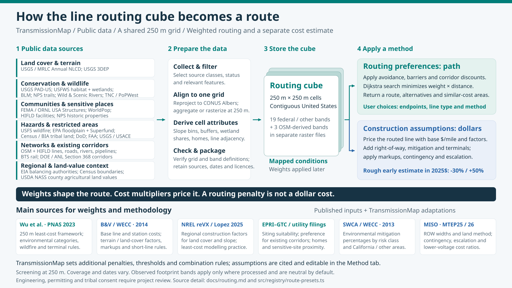

# Line routing — method

How TransmissionMap finds a route for a new overhead transmission line and estimates what it
would cost. Contributor notes (data build, engine details, checks) are in
[`internal/routing-notes.md`](internal/routing-notes.md).

[](figures/line-routing-cube.svg)

## What it is

- **Does:** finds the least-cost route for a new overhead line between two points in the
  contiguous US and prices it: line, structures, mitigation, terminals, right-of-way land,
  markups and contingency, in the method's dollar year and in 2025 dollars.
- **Also offers:** up to three alternative routes, and similar-cost areas (below).
- **Estimate range:** −30 % / +50 % around the point estimate, inside the AACE 18R-97 Class 5
  (concept screening) range of −20 to −50 % / +30 to +100 % (see *Studies cited*).
- **Is not:** an engineering design, a siting recommendation or a permitting assessment.
  Routes are illustrative. A route across tribal land needs the tribal nation's consent; the
  estimate puts no dollar value on those miles.
- **Availability:** the development build only. The routing data is not published.

## How a route is found

The contiguous US is a grid of 250 m cells. For each cell, the method gives two numbers:

- **Routing weight:** how strongly a route avoids the cell. 1 means no penalty; 100 means
  avoid unless there is no other way; 1000 means excluded. Below 1 draws a route in, as along
  existing lines.
- **Cost multiplier:** how much more a mile costs there than on flat, open land.

The route is the path with the least total routing weight × distance. Dollars are worked out
afterwards for the route found, so the route chosen is not always the one with the lowest dollar
estimate.

Each method is a list of rows, such as "forest: weight 2.25" or "GAP 1: weight 100". A row
can set the weight, the cost multiplier or both. Where several rows match one cell:

- within a group only the largest value counts: terrain (land cover or slope), protection (GAP
  status or a designation), military land (any source) and sensitive sites (facilities or
  historic properties).
- following an existing line and a Section 368 corridor take the smaller value, so the two
  discounts are not stacked.
- everything else multiplies.

The path is searched in 16 directions per cell, across an area around the straight line between
the two points. One step costs the average weight of the cells it crosses times its length.

**Proven** means the route is the cheapest on the whole grid, not only inside the area searched:
a lower bound shows no route that leaves the area could cost less. If the first search does not
prove it, a second search runs over twice the area; a route still not proven is shown and marked
as the cheapest inside the area searched.

The cell-by-cell path is then reduced to straight segments that together cost at most 0.5 %
more. That simplified line is what is priced.

**Similar-cost areas:** a cell is in the 5 % area when the cheapest route forced through that cell
has a routing cost at most 5 % above the best route's (likewise 2, 10 and 20 %).

**Alternatives** come from making cells near the routes already found more expensive and
solving again. An alternative is kept when its routing cost is at most 20 % above the best and it
shares at most half its length with the other routes.

## Data

| what | source | licence | how it is used |
|---|---|---|---|
| land cover | MRLC/USGS Annual NLCD 2025 | public domain | the most common 30 m class in each cell |
| slope | USGS 3DEP 1 arc-second elevation | public domain | average slope of the cell, in eight classes |
| protected land, designations, land manager | USGS PAD-US 4.1 | public domain | strictest GAP status in the cell; Wilderness Study Areas, monuments, roadless areas, ACECs, Wilderness, National Parks, NPS preserves, state and local parks |
| Wild & Scenic Rivers | rivers.gov | public domain | ¼ mi either side |
| National Historic and Scenic Trails | NPS | public domain | ¼ mi either side (our width; the law sets none) |
| tribal land | Census TIGER 2026, BIA land area representations | public domain | reservations, trust land and home lands |
| military land | PAD-US (DOD), DoD MIRTA; OpenStreetMap | public domain; ODbL | active installations |
| airports | FAA public-use airports and runways | public domain | within 5 km (used by the Wu method only) |
| critical habitat | USFWS, final designations | public domain | areas and stream reaches |
| sage-grouse habitat | BLM Greater Sage-Grouse habitat areas (2025 Records of Decision) | public domain | priority (PHMA-level) and general (GHMA-level) areas |
| Section 368 energy corridors | DOE / Argonne National Laboratory | public domain | the corridors |
| wildfire hazard | USDA Forest Service Wildfire Hazard Potential 2023 | public domain | high and very high classes |
| floodplain | EPA EnviroAtlas estimated 100-year floodplain | CC0 | cells at least half floodplain |
| FAA aviation screening | FAA NTAD aviation facilities, runways and runway ends | public domain | the 14 CFR 77.9(b) notice zone (class 2), the lowest Part 77 surface height above ground (classes 3 to 5) and the primary surface (class 6), evaluated against the 3DEP elevation model; a method screens at an assumed structure height per line type |
| flood hazard areas | FEMA National Flood Hazard Layer | US federal work; FEMA asks for acknowledgement of the NFHL as the source | cells at least half Special Flood Hazard Area; where FEMA has no effective map the EPA estimate is used |
| wetlands | USFWS National Wetlands Inventory; NLCD wetland classes | public domain | share of each cell |
| population | WorldPop 2020 | CC BY 4.0 | over 100 people per square mile |
| homes and buildings | ORNL / FEMA USA Structures | CC BY 4.0 | homes counted per cell; other building footprints recorded but weighted 1 by default |
| schools, hospitals, child care, nursing homes | HIFLD | CC BY 4.0 (packaging) | within 300 ft |
| historic properties | NPS National Register of Historic Places | US federal work | within 300 ft |
| Superfund sites | EPA National Priorities List, final sites | public domain | contamination footprints |
| coastal barriers | USGS Coastal Barrier Resources System | public domain | the units |
| munitions sites | USACE Formerly Used Defense Sites | public domain | open munitions response sites |
| tall structures and dams | FCC antenna structures 200 ft and over; USACE high- and significant-hazard dams | public domain | within 100 m |
| existing lines | OpenStreetMap and HIFLD, in service, 100 kV and up | ODbL; public domain | two classes, 230 kV and up and 100–229 kV; the cells a line crosses and the cells beside it |
| lakes, rivers, roads, rail, pipelines | OpenStreetMap; BTS rail network; HIFLD pipelines | ODbL; public domain | lakes are weighted; the rest are counted as crossings |
| regions | EIA balancing authorities | public domain | which regional cost set applies |
| land value | USDA Census of Agriculture 2022, county $ per acre | public domain | right-of-way land cost |

Anything derived from OpenStreetMap is kept in separate files under the ODbL. Credits for every
source are in [`data-sources.md`](data-sources.md); each layer's exact source, vintage and
processing rule are recorded with the data.

## Studies cited

| short name | what it is | used for |
|---|---|---|
| B&V 2014 | Black & Veatch, *Capital Costs for Transmission and Substations* (WECC TEPPC, 2014) ([public copy](https://efis.psc.mo.gov/Document/Display/24603)); its E3 2019 calculator update ([archived](http://web.archive.org/web/20240207092433/https://www.wecc.org/Administrative/TEPPC_TransCapCostCalculator_E3_2019_Update.xlsx)) | base line and station costs; land cover, slope and structure costs; markups; short-line factors; the Black & Veatch 2014 method |
| Wu 2023 | Wu, G. C., et al., *Power of Place*, PNAS 120(4) e2204098120 ([paper](https://doi.org/10.1073/pnas.2204098120), [supplement](https://pmc.ncbi.nlm.nih.gov/articles/PMC9942791/), [data](https://doi.org/10.5281/zenodo.7460026)) | protected-land categories, wildfire, airports, sage-grouse; 500 kV terminals; the corridors we check against |
| NREL reVX | NREL reVX least-cost transmission ([code @ efb1977](https://github.com/NREL/reVX/tree/efb1977/reVX/least_cost_xmission)) | regional cost sets; the barrier weight of 100; the NREL reVX method |
| Lopez 2025 | Lopez et al., NREL 2024 supply curves ([NREL/TP-6A20-91900](https://www.nrel.gov/docs/fy25osti/91900.pdf)) | which region takes which cost set; the NREL reVX method's region map |
| EPRI-GTC 2006 | EPRI-GTC siting methodology (EPRI 1013080, members-only) as filed by utilities ([fact sheet](https://www.gatransmission.com/wp-content/uploads/2017/08/GTC_EPRISitingMethodologyFactSheet_v2.pdf), [PPL filing](https://www.puc.pa.gov/pcdocs/1178143.pdf)) | following existing lines; avoidance areas |
| EPRI-KY 2024 | EKPC siting study, KY PSC case 2024-00108, Exhibit 19, scores out of 9 | wetland, floodplain, buildings |
| BLM 2025 RODs | BLM Greater Sage-Grouse Records of Decision, 2025 ([BLM library](https://www.blm.gov/learn/blm-library/subject-guides/greater-sage-grouse-subject-guide/planning-nepa)) | sage-grouse exemptions |
| SWCA 2013 | SWCA, *Environmental Mitigation Cost Study* for WECC (2013) | mitigation percentages |
| WestTEC ES | Energy Strategies, Transmission Cost Estimator for WestTEC (Western Power Pool) | the WestTEC (Energy Strategies) method's line modifiers |
| MISO | MISO Transmission Cost Estimation Guide for MTEP25 ([guide](https://cdn.misoenergy.org/MISO%20Transmission%20Cost%20Estimation%20Guide%20for%20MTEP25337433.pdf)) and MTEP26 workbook ([workbook](https://cdn.misoenergy.org/MISO%20Transmission%20Cost%20Estimation%20Workbook%20for%20MTEP26547535.xlsx)) | escalation, contingency, right-of-way widths and developed-land values, lower-voltage cost ratios, the straight-line method |
| PJM 2025 | PJM DESTF cost evaluation, 2025-07-15 | contingency |
| CAISO 2025 | CAISO participating transmission owner per-unit costs, 2025 ([CAISO](https://stakeholdercenter.caiso.com/RecurringStakeholderProcesses/Participating-transmission-owner-per-unit-costs-2025)) | comparison only |
| AACE | AACE International Recommended Practice 18R-97, as quoted in a [West Contra Costa TAC study](https://www.westcontracostatc.gov/documents/view/420) | the estimate range |

## How it's priced

```
line         = Σ over cells (base $/mi × the cell's cost multiplier × miles in the cell) × short-line factor
mitigation   = line × a percentage set by the cell's environmental risk class
markups      = (line + ROW land) × 0.175
terminals    = number of stations × cost each
contingency  = 30 % × (line + markups + mitigation + terminals + ROW land)
2025 dollars = total × 1.04 ^ (2025 − dollar year)
estimate     = 2025 total × 0.70 to 1.50
```

| item | TransmissionMap default | source |
|---|---|---|
| base cost per mile (2014$) | AC double circuit: 500 kV $3,071,750, 345 kV $2,150,300, 230 kV $1,536,400; 500 kV HVDC bipole $1,536,400 | B&V 2014 |
| escalation | 4 % a year to 2025 | MISO |
| terminals | a station at each end. 500 kV: $87.9 M each (2018$), plus one more per 400 mi beyond the first 400; 345 kV $22.3 M and 230 kV $15.1 M (2014$, six breaker-and-a-half positions); HVDC $460.7 M per converter (two per line) | Wu 2023; B&V 2014 |
| mitigation | % of line cost by risk class 1 / 2 / 3: California 2.0 / 1.0 / 5.5 %, elsewhere 0.5 / 0.5 / 1.0 %. Class 3 = GAP 1–2 or critical habitat; class 2 = GAP 3 or federal land; class 1 = a Section 368 corridor or an existing line of 230 kV and up | SWCA 2013 |
| markups | AFUDC 7.5 % + overhead 10 % | B&V 2014; Wu 2023 |
| contingency | 30 %. B&V's costs carry none, so it is not counted twice | MISO; PJM 2025 |
| short-line factor | × 1.5 under 3 mi, × 1.2 for 3–10 mi | B&V 2014 |
| right-of-way land | width × length × county land value; × 5 on developed land; federal land priced as private; tribal land $0. Widths: 500 kV 250 ft, 345 kV 200 ft, 230 kV 150 ft, HVDC 200 ft, 161 / 138 / 115 / 69 kV 100 / 95 / 90 / 80 ft | B&V 2014; MISO; USDA Census of Agriculture 2022 |
| regional cost sets | land cover and slope costs follow the cell's region: CAISO, NYISO, ISO-NE and PJM take reVX's SCE set; MISO and SPP the MISO set; ERCOT and the Southeast the Southeast set; elsewhere B&V. Costs only: routing is the same everywhere | NREL reVX; Lopez 2025 |

**Lines below 230 kV.** B&V prices 230 kV and up. For 69–161 kV, the line and terminal costs are
B&V's 230 kV values times MISO's ratio for that voltage (MTEP26 double-circuit costs, with land,
contingency and AFUDC removed). In populated cells these voltages keep the 230 kV structure
multiplier of 1.1, because no source gives a lower one.

## Weights

**WPP** (Western Power Pool) marks the values in the TransmissionMap default method. The other
columns give what each study uses for the same thing; "—" means it has none. The Method tab names
one of these studies for each row, or WPP where the value is our own choice.

**Land cover, slope and structures (cost multiplier)**

| category | B&V 2014 | Wu 2023 | reVX SCE | reVX MISO | reVX Southeast | **WPP weight** |
|---|---|---|---|---|---|---|
| forest | 2.25 | 2.25 | 3 | 1.2 | 1.47 | **2.25** |
| developed, low/medium | 1.27 | — ¹ | 2 | 1.08 | 1.75 | **1.27** |
| developed, high | 1.59 | 1.59 | 3 | 1.2 | 1.12 | **1.59** |
| barren | 1.05 | 1.05 | — ² | — ² | — ² | **1.05** |
| wetland | 1.2 | 1.2 | 2 | 1.8 | 1.33 | **2.5** ³ |
| open water | 1.2 | 1.2 | 2 | 1.8 | 1.33 | **1.2** |
| cultivated crops | 1 | — | 1 | 1.03 | 1 | **1** |
| rolling, 1–4° | 1.4 | 1.4 | 1.5 | 1.1 | 1.2 | **1.4** |
| mountain, 4° and up | 1.75 | 1.75 | 2 | 1.21 | 1.6 | **1.75** |
| ice/snow | — | — | — | — | — | **1.75** (as mountain) |
| populated, 230 / 345 / 500 kV (tubular steel) | 1.1 / 1.3 / 1.5 | 1.1 / 1.3 / 1.5 | — | — | — | **1** (cost multiplier 1.1 / 1.3 / 1.5) |

WPP's cost multiplier for land cover and slope is the column of the cell's region (see *How it's
priced*); its routing weight is the B&V value everywhere.
¹ Wu has one urban class (1.59). ² reVX has no barren class (1). ³ The cost multiplier stays 1.2.

**Protected land, hazards and siting (routing weight)**

| category | Wu 2023 | EPRI | other | **WPP** |
|---|---|---|---|---|
| GAP 1 (strict protection) | Category 1: 100 ⁴ | — | — | **100** |
| GAP 2 | Category 2: 20 ⁴ | — | — | **10** |
| GAP 3 | Category 3: 15 ⁴ | — | — | **2** |
| Wilderness Study Area | risk class 4 | — | — | **excluded** |
| Wilderness, National Park | — | — | — | **excluded** |
| National Monument, Roadless Area, ACEC | risk class 3 | — | — | **10** |
| National Historic/Scenic Trail, other special areas | risk class 2 | — | — | **2** |
| Wild & Scenic River | Category 1: 100 | KY: avoid | — | **100** |
| sage-grouse priority habitat (PHMA) | Category 2: 20 | — | BLM: avoidance area | **20** |
| sage-grouse general habitat (GHMA) | — | — | BLM: open | **1.5** |
| FAA Part 77 surface below the assumed structure height (61 m at 500 kV, 46 m at 230 and 345 kV, 30 m below) | airports within 5 km: 100 (cost multiplier 1.2) | — | — | **100** (cost multiplier 1.2); notice zone: 1 |
| military land | — | — | reVX barrier: 100 | **100** |
| tribal land | not studied ⁵ | — | — | **100** |
| wildfire hazard, high / very high | 1 to 5 by risk | — | — | **1.03 / 1.5** (also the cost multiplier) |
| on or beside a 230 kV+ line | 9 inside existing ROW ⁶ | GTC: corridor 1 vs open land 2 | — | **0.5** |
| beside a 100–229 kV line | — | GTC: most suitable | — | **0.7** |
| Section 368 corridor | — | — | — | **0.8** |
| wetland (NLCD, or NWI over half the cell) | 1.2 | KY: 8.7–9 of 9 | — | **2.5** |
| NWI wetland, a quarter to half the cell | — | — | — | **1.5** |
| EPA estimated floodplain, where FEMA has no effective map | — | KY: 9 of 9 | — | **1.5** |
| FEMA Special Flood Hazard Area | — | KY: 9 of 9 | — | **1.5** |
| homes in the cell: 1–2 / 3–9 / 10+ | — | KY: next to a building 9 vs background 4.4 | Texas counts homes near a route | **1.3 / 1.6 / 2.0** |
| school, child care, hospital, nursing home, historic property | — | GTC: avoid | — | **10** |
| Superfund site | — | KY: avoid | — | **100** |
| critical habitat | — | — | — | **5** |
| state or local park | — | — | state park rules | **5** |
| lake | — | — | — | **20** |
| coastal barrier, munitions site, tall structure or dam | — | — | — | **3** |
| other building footprints | — | — | — | **1** (recorded, not weighted) |

⁴ Wu's categories are land classes from The Nature Conservancy, not GAP status; this is the
nearest match. ⁵ Wu left tribal land out of the study area. ⁶ Wu's 9 keeps a new line *out of*
an existing right-of-way; WPP's 0.5 draws it alongside.

**Why WPP differs where it does**

- **Wetland 2.5:** EPRI-KY scores wetland near its top score, and a crossing needs a Clean Water Act
  §404 permit and matting, so wetland is weighted above forest.
- **GAP 2 and 3, designations:** a step below GAP 1 per class; designations take the GAP weight of
  their Wu risk class.
- **Excluded areas:** Wilderness, National Parks and Wilderness Study Areas. The weight is 1000,
  not infinite, so a route that starts inside still solves.
- **Wild & Scenic Rivers 100, not excluded:** excluding a river corridor this narrow forces very
  long detours.
- **Following existing lines:** 0.5 is the EPRI-GTC ratio (1 against 2). It is weaker beside
  100–229 kV lines, because a larger line there usually needs new width.
- **Homes:** 2.0 is EPRI-KY's 9 ÷ 4.4; 1.3 and 1.6 are our steps below it. Homes multiply with
  land cover, so a farmstead in woods counts both.
- **Floodplain 1.5:** a line can span a floodplain, and the layer covers about a tenth of the land,
  so it stays below GAP 3. A floodplain counts once (the § Data rule: FEMA where it has an effective map, else EPA).
- **Aviation 100:** a cell where an FAA Part 77 surface lies below the assumed structure height is weighted as Wu weights airports within 5 km. This is screening; the FAA decides through its obstruction evaluation (Form 7460-1).
- **Tribal land 100:** a crossing needs the tribal nation's consent.
- **The rest** (critical habitat, parks, lakes, coastal barriers, munitions sites, tall structures,
  general sage-grouse habitat, very high wildfire hazard, Section 368) are our judgment; no study
  gives a value.

**Sage-grouse exemptions.** The priority-habitat row does not apply in three cases, each a
checkbox in the Method tab:

| exemption | default | basis |
|---|---|---|
| inside a Section 368 corridor | on | the 2025 RODs open designated corridors in priority habitat to new major lines |
| on or beside a 230 kV+ line | off | outside corridors, the RODs keep priority habitat an avoidance area; building beside a line is a siting condition, not an exemption |
| on or beside a 100–229 kV line | off | as above, for 69–161 kV lines |

The row applies to every voltage.

## Methods

- **TransmissionMap default:** everything above.
- **Power of Place – West (Wu 2023):** Wu's Table S7 weights, Table S5 line costs and
  Table S6 terminal rules, in 2018 dollars, over the 11 western states, with no contingency and
  no mitigation. It differs from the paper in: newer inputs (NLCD 2025, WHP 2023 for Wu's
  wildfire risk layer, existing lines from OpenStreetMap and HIFLD); no right-of-way land layer
  (Wu used BLM's); our path search in place of ArcGIS's; the two new-build line types only; and a
  weight of 15 for tribal land (Wu's Category 3 weight), which the paper left out of its study area.
- **Straight line × 1.30:** no route is solved. Length is the straight-line distance × 1.30
  (MISO), priced with the default base costs.
- **NREL reVX least-cost transmission:** reVX's TEPPC land-use × slope multipliers and its water
  multiplier of 10 route everywhere; the regional base costs and multiplier sets (Lopez 2025's
  region map) change cost only, not the route. GAP status 1 land is excluded (Lopez). Short lines
  take reVX's stepped short-line factors (reVX's default is linear). Costs are in 2019 dollars with
  no markups, and terminals are one substation upgrade per end. Left out: the SWCA risk-4
  exclusion and mitigation dollars, and reVX's barrier layers (unpublished), so apart from GAP 1
  no tribal, military or protected land is weighed; no HVDC line type (reVX models none).
- **Black & Veatch 2014 (WECC TEPPC):** B&V's Table 2-5 WECC terrain multipliers, one per cell
  (the largest that applies), set the cost of a cell. B&V gives costs only; using the same
  multipliers to route is ours. AFUDC and overhead apply to line and stations. There is no
  right-of-way land cost: BLM-zone pricing has no layer here. No tribal, military or protected
  land is weighed.
- **WestTEC (Energy Strategies):** an imitation of the WestTEC cost estimator's scales
  on our public routing data: its line modifiers, multiplied together (overlapping military or
  designation areas count once). Where the estimator is silent we choose which PAD-US designations
  take 4.0 and which 1.2, follow existing lines of 230 kV and up (a cell beside a line counts as on
  it), and use a 5 km airfield buffer. Other base costs and the stations are the default method's.

The four study methods carry aviation and flood rows of weight 1 that only report miles. Methods
can be edited in the Method tab and saved by name in the browser.

## How it was checked

Routes are compared with two published sets of new lines: Wu 2023's 27 western corridors and
WestTEC's planned new lines. This measures agreement with another model and with planned lines,
not accuracy against lines as built. No value is tuned to either set.

| check | target |
|---|---|
| Wu's corridors costed on our data (Power of Place method): ours ÷ Wu's cost, median | within ±15 % |
| Wu's corridors routed by us: length | median within 5 %, 80 % within 15 % |
| the same: line cost per mile | median within 10 %, 80 % within 25 % |
| the same: mean distance from Wu's line, median | ≤ 10 km |
| WestTEC's new lines: length, distance, cost | report only |

WestTEC's costs leave out contingency, overheads and terminals, which the default method includes.

The current figures print with
`npx vitest run --config vitest.route.config.ts assets/route/route.validate.test.ts` (needs the routing cube).

## Limits

- Screening grade: 250 m cells and planning-level cost tables. A feature narrower than a cell
  takes the whole cell.
- Contiguous US only. Distances are on an equal-area projection, within about 1.25 % of ground
  distance.
- Similar-cost areas and alternatives are skipped, with the reason shown, on routes too long for
  the memory limit; the route itself still returns.
- Inputs have different dates; the oldest are WorldPop 2020 and the USA Structures imagery.
- The 4 %/yr escalation is above the producer-price trend (about 3 %/yr); the difference sits
  inside the estimate range.
- Federal right-of-way is priced as private land; BLM and USFS rent schedules are not modelled.
- Mitigation percentages come from 29 western projects (SWCA 2013) and are applied nationally.
- HVDC: the converter count has no stated source; the estimate says so.
- Regional sets change dollars only; routing weights are national.
- Uploaded polygon layers are limited by memory.
- Not modelled: homes within 300 / 500 ft of the
  line (the cell count is a proxy), BLM visual resources, land-use plan exclusions outside the
  layers above, local ordinances, ice and wind loading, reconductoring or co-locating on an
  existing line.
- Sensitive conservation easements are not in PAD-US, so they are not in the data.
- Roadless areas follow the 2001 rule.
